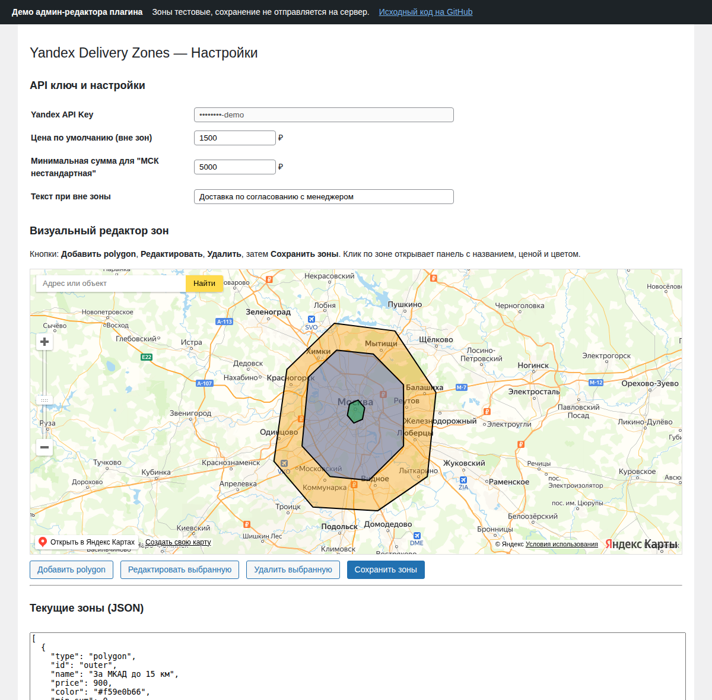

# Woo Yandex Delivery Zones

WordPress plugin that calculates WooCommerce shipping by delivery zones drawn on Yandex Maps.
The store owner draws zones and sets a price for each; at checkout the customer picks an address
and the plugin checks on the server which zone it falls into.

**[Live demo of the admin editor](https://hammod-m.github.io/woo-yandex-delivery-zones/demo/)** — test data, nothing is saved.



## Features

- **Visual zone editor** in WP Admin on Yandex Maps: add polygons, edit vertices, delete zones; a side panel sets each zone's name, price and color.
- **JSON view** of all zones that can be edited by hand and applied back to the map.
- **Import from GeoJSON** — a `FeatureCollection` or an InSales export (`insalesData.title` / `price` are picked up), so zones can be moved from another platform.
- **Checkout map**: address search via Yandex geocoder, a marker on the chosen address, the zone and price shown in a balloon; a default price and message for addresses outside every zone.
- **Server-side check**: the address coordinates go to `admin-ajax.php`, the zone is found with a point-in-polygon test in PHP, and the price is stored in the WooCommerce session — the client cannot set its own price.
- **Three shipping methods**: courier by zone, pickup, and a "non-standard" courier option with a minimum order amount.
- The chosen zone is saved to the order meta for managers.

## Requirements

WordPress with WooCommerce, PHP 7.4+, and a key for the Yandex Maps JavaScript API 2.1.

## Installation

1. Copy the plugin folder to `wp-content/plugins/` and activate **Woo Yandex Delivery Zones**.
2. Go to **WooCommerce → Yandex Delivery Zones**, enter the Yandex Maps API key — the API script is loaded automatically.
3. Draw zones (or paste GeoJSON into the JSON field), set prices and click **Save zones**.
4. Enable the shipping method **"Курьер (Yandex zones v3)"** in WooCommerce shipping settings.

## Zone format

```json
[
  {
    "type": "polygon",
    "id": "mkad",
    "name": "Within MKAD",
    "price": 500,
    "color": "#2563eb66",
    "min_sum": 0,
    "coordinates": [[[37.37, 55.66], [37.40, 55.84], [37.53, 55.91], [37.37, 55.66]]]
  }
]
```

Coordinates follow GeoJSON order: `[longitude, latitude]`.

## Project structure

| Path | What it does |
|---|---|
| `woo-yandex-delivery-zones.php` | Plugin bootstrap, settings page, AJAX endpoints, point-in-polygon check, WooCommerce shipping methods |
| `admin/admin.js` | Zone editor on Yandex Maps |
| `public/delivery-map-v2.js` | Checkout map: geocoding, marker, zone lookup |
| `demo/` | Static demo of the editor for GitHub Pages |

## License

GPL-2.0-or-later, like WordPress itself.
